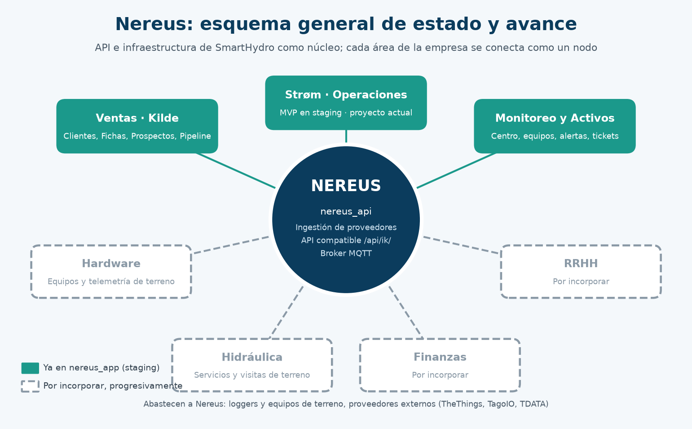
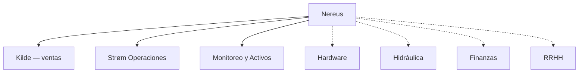
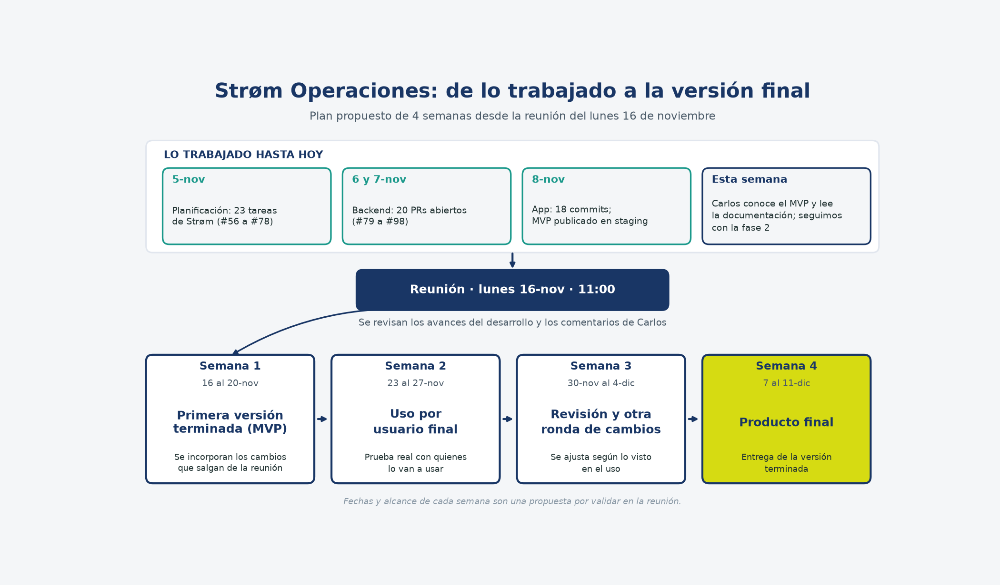
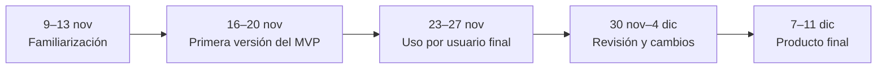

# Nereus

App de SmartHydro para ver la telemetría, vender, operar en terreno y dar soporte, en un solo escritorio.

[](https://github.com/felipebarraza6/nereus_app/actions/workflows/ci.yml)
[](https://github.com/felipebarraza6/nereus_app/actions/workflows/pages.yml)
[](https://docs.flutter.dev/)

**Staging (MVP):** [https://felipebarraza6.github.io/nereus_app/](https://felipebarraza6.github.io/nereus_app/)

> El sitio de staging se publica desde la rama `staging` y, en ese build, habla con el API de producción. Entra con **datos de demostración**. No uses cuentas reales.

---

## Qué es

Nereus es la aplicación Flutter de SmartHydro (web, Android, iOS y escritorio). Sirve para que el equipo vea los puntos de captación, atienda tickets, gestione el flujo comercial y, ahora, organice las operaciones de instalación y terreno de **Strøm**.

No hace falta instalar nada para recorrer el MVP: el sitio de staging abre un modo de demostración con datos de ejemplo.

## Estado actual

Hoy el escritorio reúne estos módulos (nombres tal como aparecen en la barra lateral):

| Módulo | Qué incluye hoy |
| --- | --- |
| **Kilde** | Clientes, fichas, levantamientos, prospectos y pipeline (flujo comercial). |
| **Strøm — Operaciones** | Proyectos, visitas, actividades, check de terreno, check técnico, aclaraciones, auditoría, indicadores y configuración. Hay una pantalla Dev con el flujo. |
| **Monitoreo** | Inicio, operación de dispositivos y tickets. |
| **Activos** | Catálogo, inventario y equipos. |
| **Red** | Puntos de captación. |

De forma progresiva, el esquema apunta también a **Hardware**, **Hidráulica**, **Finanzas** y **RRHH**. Esos cuatro módulos todavía no están en la app (propuesta).





*Las cajas punteadas son el esquema a futuro (propuesta). No aparecen aún en el código.*

## Cómo probar el staging

1. Abre [https://felipebarraza6.github.io/nereus_app/](https://felipebarraza6.github.io/nereus_app/) en un navegador, idealmente en una ventana ancha (960 px o más).
2. En el escritorio de bienvenida, entra a un módulo con **datos de demostración**, o pulsa **Entrar con datos de demostración**.
3. Recorre **Strøm — Operaciones** desde la barra lateral (Proyectos, Visitas, etc.).

Notas:

- En una pantalla estrecha el botón de demostración puede no aparecer (en el código solo se muestra en ventanas anchas, en modo debug o si la app ya está en modo demostración).
- El build publicado **no** activa el modo demostración por defecto: apunta al API de producción. Por eso hay que entrar con el botón de demostración y no con una cuenta real.
- La demostración usa datos de ejemplo en el dispositivo; no escribe en la operación real.

Para recorrerlo en tu máquina, sin backend:

```bash
flutter pub get
dart run build_runner build --delete-conflicting-outputs
flutter run --dart-define=NEREUS_DATA_MODE=fixture
```

## Plan de 4 semanas (propuesta)

A partir de la reunión del lunes 16 de noviembre de 2026, a las 11:00 (hora de Chile):

| Semana | Fechas | Objetivo |
| --- | --- | --- |
| Esta semana | 9 al 13-nov | Familiarizarse con el MVP y la documentación, mientras avanza la fase 2. |
| Semana 1 | 16 al 20-nov | Primera versión terminada del MVP. |
| Semana 2 | 23 al 27-nov | Uso por usuario final. |
| Semana 3 | 30-nov al 4-dic | Revisión y otra ronda de cambios. |
| Semana 4 | 7 al 11-dic | Producto final. |





El seguimiento de issues y pull requests de Strøm está en el tablero [Strøm Operaciones](https://github.com/users/felipebarraza6/projects/12). El proyecto pertenece al usuario `felipebarraza6`, es privado, y los issues viven en el API (`nereus_api`, también privado). Para ver el Kanban hace falta un usuario de GitHub y que te den acceso al proyecto y al repositorio del API.

## Documentación

Índice completo en [`docs/README.md`](docs/README.md).

| Documento | Contenido |
| --- | --- |
| [Qué es y cómo probar](README.md) | Esta portada. |
| [SPEC.md](docs/SPEC.md) | Especificación de producto (objetivos, pantallas, stack). |
| [DESIGN.md](docs/DESIGN.md) | Sistema de diseño (paleta, layout, estados, accesibilidad). |
| [JOURNEY.md](docs/JOURNEY.md) | Recorrido funcional y endpoints que existen en el API. |
| [API_CONTRACT.md](docs/API_CONTRACT.md) | Contrato de runtime del API que usa la app. |

---

## Revisión profunda (técnica)

### Arquitectura

La app es un cliente Flutter con organización por *features*. El arranque está en `lib/main.dart` (`ProviderScope` + `NereusApp`). El enrutado es `go_router` (`lib/core/routing/app_router.dart`). El estado y las dependencias se resuelven con Riverpod 3 (`lib/core/providers.dart`).

Hay dos modos de datos (`NereusDataMode` en `lib/core/config/app_config.dart`):

| Modo | Cómo se activa | Qué hace |
| --- | --- | --- |
| `yggdra` (por defecto) | Sin `NEREUS_DATA_MODE`, o cualquier valor distinto de `fixture` | Habla con el API por Dio. |
| `fixture` | `--dart-define=NEREUS_DATA_MODE=fixture`, o el botón de demostración en runtime | Usa datos de ejemplo (sin backend). |

La URL del API se toma de `--dart-define=NEREUS_API_BASE`. Si no se pasa:

- en **debug**, el origen es `http://localhost:8000`;
- en **release**, el origen es `https://gateway.smarthydro.app`.

El cliente HTTP agrega `Authorization: Token …` y `X-Branch-ID` (`lib/core/network/auth_interceptor.dart`). El login es `POST /api/accounts/users/login_complete/`. El rol de sucursal (`role_code`) distingue cliente (`CL`) y equipo; no se usa `type_user` para ese corte.

En web, la caché de lectura vive en memoria. En el resto de plataformas se usa Drift, con respaldo a memoria si la base local no arranca. Un 401 limpia la sesión local.

### Stack

Verificado en `pubspec.yaml`, `.fvmrc` y el código:

| Pieza | Detalle |
| --- | --- |
| Flutter | 3.47.6 (`.fvmrc` y los workflows de CI / Pages) |
| Dart | SDK `^3.13.5` |
| Estado | `flutter_riverpod` 3 + `riverpod_generator` |
| Modelos | `freezed`, `json_annotation` |
| Rutas | `go_router` |
| HTTP | `dio` + cliente OpenAPI en `packages/nereus_api_client` |
| Caché / offline | `drift` (memoria en web) |
| Auth local | `flutter_secure_storage` (en web, `SharedPreferences`) |
| Mapas y gráficos | `flutter_map`, `fl_chart` |
| i18n | `flutter_localizations`, `l10n/` (español de Chile por defecto) |
| Análisis | `very_good_analysis` (`analysis_options.yaml`) |
| Plataformas | Android, iOS, web, macOS, Windows, Linux |

### Cómo correr en local

Requisitos: Flutter 3.47.6 y Dart 3.13.

```bash
flutter pub get
dart run build_runner build --delete-conflicting-outputs

# Debug: API local en http://localhost:8000
flutter run

# Demo sin backend
flutter run --dart-define=NEREUS_DATA_MODE=fixture

# Gateway de SmartHydro (producción). No lo uses con cuentas reales para una demo.
flutter run --dart-define=NEREUS_API_BASE=https://gateway.smarthydro.app/api
```

Tests:

```bash
flutter analyze
flutter test
```

El workflow `.github/workflows/ci.yml` corre análisis, tests y un build web/Android en `main`, `dev` y `staging`. El workflow `.github/workflows/pages.yml` publica `staging` en GitHub Pages con `--base-href /nereus_app/`.

Para regenerar el cliente OpenAPI hace falta un checkout de referencia del API y Java 17:

```bash
bash tool/gen_api.sh
```

### Estructura de carpetas

```
lib/
  main.dart              # arranque
  app.dart               # MaterialApp.router, tema e i18n
  core/                  # config, rutas, red, caché, tema, widgets
  features/              # un folder por dominio
    auth/  home/  strom/  telemetry/  devices/
    tickets/  alerts/  customers/  crm/  fichas/
    catalog/  inventory/  equipment/  points/
    org/  profile/  settings/  tour/
  l10n/
packages/nereus_api_client/   # cliente generado
docs/                         # especificación y contrato
tool/                         # gen_api.sh y utilidades
```

Cada *feature* se organiza, cuando aplica, en `data/`, `domain/`, `presentation/` y `providers/`.

### Convenciones

- Textos de la interfaz en español de Chile.
- Archivos de *feature* livianos; la guía interna pide mantenerlos cerca de ~400 líneas.
- No implementar envío DGA/SMA ni escrituras de configuración de administración en este cliente.
- El contrato real del JSON se verifica contra el API (y `docs/API_CONTRACT.md`); OpenAPI a veces tipa mal campos calculados.
- El trabajo de producto de Strøm se integra en `dev` / `staging`. La rama por defecto del repo es `main`. Hoy `dev` y `staging` apuntan al mismo commit; `main` va más atrás. No se publica ni se empuja directo a `main` desde esta documentación.

Paleta de marca en `lib/core/theme/tokens.dart`: azul `#193665`, lima `#D6DB12`.
